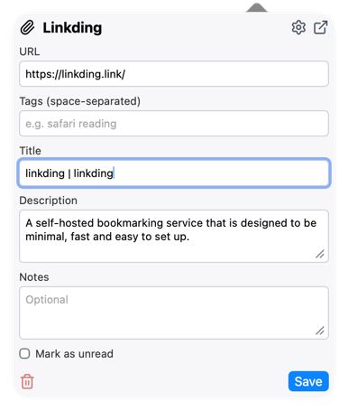
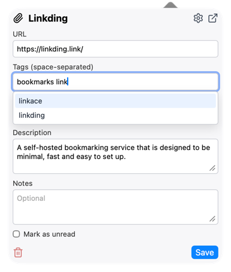
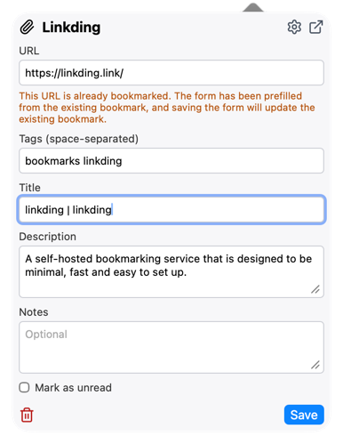
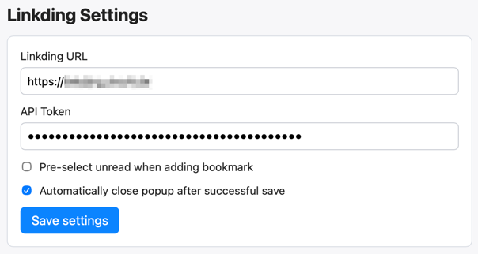

# Linkding Safari Extension

A Safari Web Extension to quickly save the current page to your [Linkding](https://linkding.link) instance.

## Features

- Save current tab with a popup form:
  - title (pre-filled)
  - URL (pre-filled)
  - description (auto-filled from page meta tags)
  - notes
  - mark as unread
  - tags
- Automatic description extraction from the active page (fallback order):
  - `meta[name="description"]`
  - `meta[property="og:description"]`
  - `meta[name="twitter:description"]`
- Duplicate detection when popup opens
- Existing bookmark prefill:
  - if URL already exists, the form is prefilled from the existing bookmark
  - a hint is shown below the URL field
  - saving updates the existing bookmark
  - existing bookmark can be deleted from the popup (trash button)
- Tag autocomplete dropdown (loaded from Linkding API)
  - keyboard navigation with ↑/↓ and Enter
- Quick actions in popup header:
  - open Linkding instance
  - open extension settings
- Options page for:
  - Linkding base URL
  - API token
  - optional auto-close on successful save
- Keyboard shortcut to save current page directly:
  - macOS: `⌘ + ⇧ + L`
  - default: `Ctrl + Shift + L`

## Screenshots

### Popup

### Tag Suggestions

### Duplicate Detection

### Settings

## Project structure

- Safari wrapper project: `Linkding Safari.xcodeproj`
- Web extension files: `Shared (App)/Resources/`
  - `manifest.json`
  - `popup.html`, `popup.css`, `popup.js`
  - `options.html`, `options.css`, `options.js`
  - `background.js`

## Build and run with Xcode (Safari, macOS only)

### Prerequisites

- macOS with Safari
- Xcode (recent version)
- Apple developer signing (Personal Team is fine for local testing)

### 1) Open the project

Open:

- `Linkding Safari.xcodeproj`

### 2) Configure signing

In Xcode, for both targets:

- `Linkding Safari (macOS)`
- `Linkding Safari Extension (macOS)`

set:

- **Team** (same team for both targets)
- **Automatically manage signing** enabled

Also verify bundle identifiers are consistent:

- App: `de.zisoft.linkding-safari`
- Extension: `de.zisoft.linkding-safari-extension`

### 3) Build and run

- Select scheme: **Linkding Safari (macOS)**
- Run: `⌘R`

### 4) Enable extension in Safari

- Open Safari
- Go to **Settings → Extensions**
- Enable **Linkding Safari**

If Safari does not show the extension immediately, quit and relaunch Safari once.

### 5) Configure extension

- Open extension popup
- Click **Settings**
- Enter:
  - Linkding URL (for example: `https://linkding.example.com`)
  - API token
- Save settings

## Notes

### Host permissions

`manifest.json` uses:

- `https://*/*`

This allows connecting to any HTTPS-hosted Linkding instance configured in the extension settings.

### Known limitations

- Some pages (for example Safari internal pages, browser stores, or protected pages) may block script injection. In those cases, auto-description may remain empty.
- The duplicate check is URL-based. Different URL variants (for example tracking parameters) may be treated as separate entries by Linkding.
- Auto-filled descriptions are truncated to 500 characters.

### API reference

- https://linkding.link/api/
